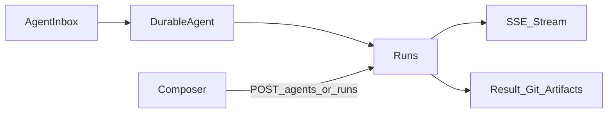
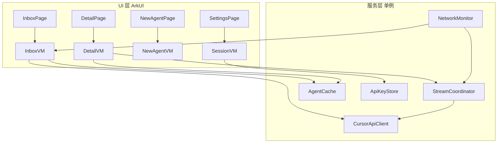
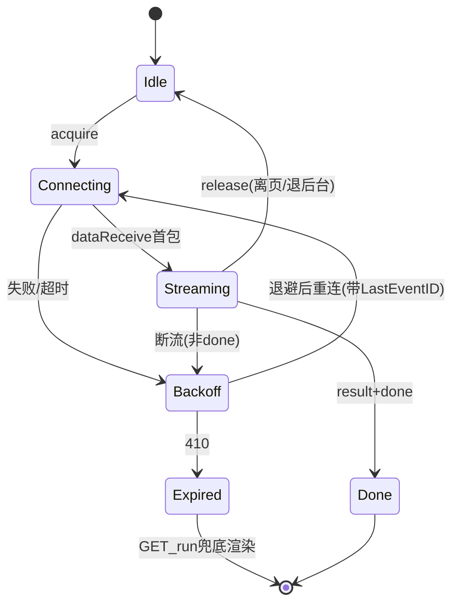
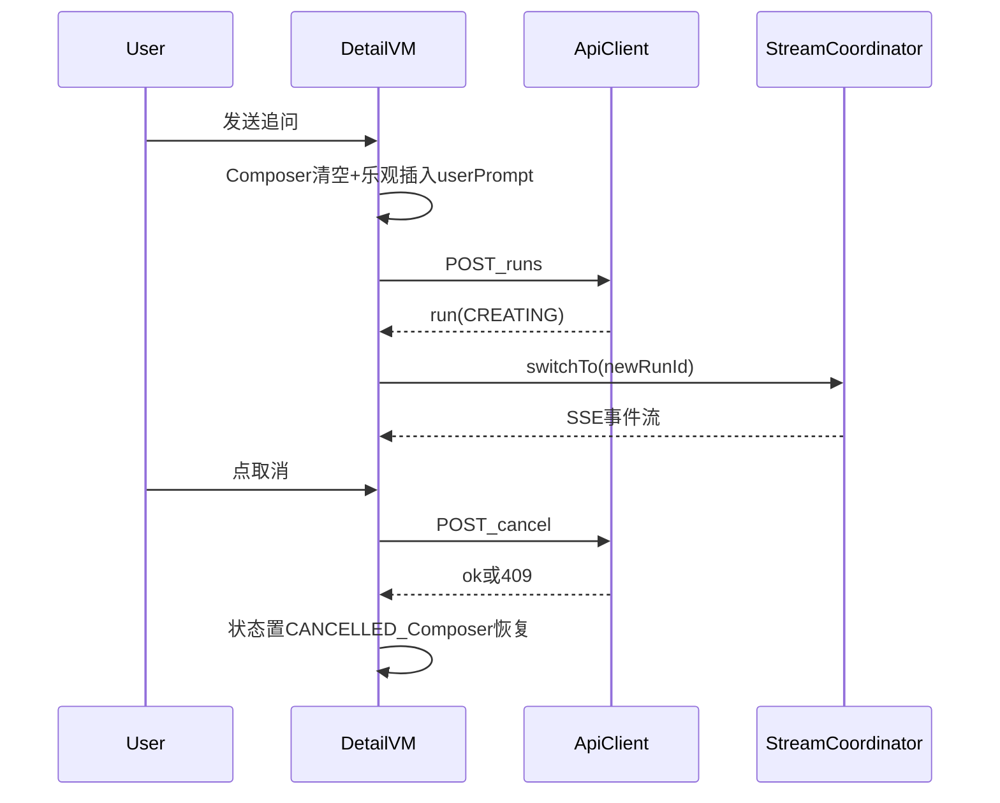

# Cursor Cloud Agents 鸿蒙原生客户端 — 落地设计方案（细化版）

## 0. 工程基线（已确认）

| 项 | 值 | 来源 |
|----|----|------|
| compileSdk / targetSdk | `6.1.1(24)`，兼容 `5.0.0(12)` | [`build-profile.json5`](build-profile.json5) |
| 签名 | 已配置 default 签名，可直接出可装 HAP | 同上 |
| 设备 | phone + tablet；用户主力机为 Pura X Max（折叠） | [`entry/src/main/module.json5`](entry/src/main/module.json5) |
| 已有权限 | `INTERNET`、`GET_NETWORK_INFO`、`MICROPHONE`（本期移除，V1.2 语音再加回） | 同上 |
| 现有壳 | `pages/Index.ets` WebView/外跳壳（PARKED），本期整体替换 | [`entry/src/main/ets/pages/Index.ets`](entry/src/main/ets/pages/Index.ets) |
| 窗口 | 已做深色 + `setWindowLayoutFullScreen(true)` + 系统栏配色 | [`entry/src/main/ets/entryability/EntryAbility.ets`](entry/src/main/ets/entryability/EntryAbility.ets) |

API 24 意味着：`http.on('dataReceive')` 流式在该版本上稳定性良好（社区反馈 API 24 已显著改善），SSE 主路径可行；仍保留非流式回退。

---

## 1. 产品定位（锚定 Cursor，而非通用聊天）

本应用是 **Cursor Cloud Agents 的鸿蒙指挥台**，对标官方 [Cursor for iOS](https://cursor.com/docs/cloud-agent/mobile.md)：

- **做**：启动 / 跟进 / 追问 / 取消云端 Agent；看运行时间线、结果、分支与 PR、Artifacts；与 `cursor.com/agents` 共用同一批 Agent。
- **不做**：IDE、终端、完整文件树、Secrets/Environment 配置、MCP 管理、计费后台、Remote Desktop 操控。
- **不走**：ArkWeb / 卓易通网页壳（Cloudflare 已验证失败）。

核心心智模型与 API v1 一致：



- **Agent**：持久会话实体（`bc-...`），含 repos、status（ACTIVE/ARCHIVED）、latestRunId、url。
- **Run**：一次 prompt 提交（`run-...`）；状态机独立；SSE 只属于单个 run，不回放历史。
- **Outcome**：`result` 文本 + `git.branches[]`（branch/prUrl，**per-agent 快照**）+ artifacts。

---

## 2. API 契约（数据源与规则）

Base：`https://api.cursor.com`；鉴权 `Authorization: Bearer <crsr_...>`；全部 JSON。

### 2.1 端点清单与调用策略

| 端点 | 用途 | 调用策略 |
|------|------|---------|
| `GET /v1/me` | 校验 key、取账号信息 | 保存 key 时 + 冷启动静默校验 |
| `GET /v1/agents?limit=&cursor=` | Inbox | 页面进入 + 下拉 + 前台每 60s（仅页面可见且存在活跃 run 时） |
| `GET /v1/agents/{id}` | 详情（repos、workOnCurrentBranch、autoCreatePR、latestRunId） | 进详情时；list 项只有 durable 字段，详情必须单独拉 |
| `POST /v1/agents` | 创建（prompt/model/repos/mode/autoCreatePR/images） | 提交后立即拿 `{agent, run}` 跳详情 |
| `GET /v1/agents/{id}/runs?limit=` | run 历史 | 进详情时一次；追问后本地 append |
| `GET /v1/agents/{id}/runs/{runId}` | run 终态（result/durationMs/git） | SSE 不可用或 410 时的回退；CREATING 期兜底轮询 |
| `GET .../runs/{runId}/stream` | SSE 实时流 | 详情页且 run 非终态时挂 1 条；`Last-Event-ID` 续流 |
| `POST /v1/agents/{id}/runs` | 追问（prompt/model 覆盖/mode） | Composer 发送；返回新 run 后切流 |
| `POST .../runs/{runId}/cancel` | 取消 | 运行中显示；409 run_not_cancellable 静默刷新状态 |
| `GET /v1/models` | 模型 + params + variants | 缓存 24h；新建页首次打开时拉 |
| `GET /v1/repositories` | GitHub 仓库列表 | **严格限流（参考 v0：1次/分钟）**：缓存 24h，仅手动「刷新仓库」触发 |
| `GET /v1/agents/{id}/artifacts` + `/download` | 交付物列表 + 15min 预签名 URL | V1.1；详情 Outcome 区入口 |
| `POST .../archive` / `DELETE /v1/agents/{id}` | 归档 / 永久删除 | 溢出菜单；删除需二次确认 |
| `GET /v1/agents/{id}/usage` | token 用量 | V1.1；详情次级信息 |

### 2.2 SSE 事件契约

事件：`status` / `assistant` / `thinking` / `tool_call` / `interaction_update` / `heartbeat` / `result` / `error` / `done`。

- **只消费简化事件**（assistant/thinking/tool_call/status/result），忽略 `interaction_update`（官方明确二选一）。
- `tool_call`：`{ callId, name, status: running|completed, args?, result?, truncated? }`，按 `callId` 原地合并。
- 事件带 `id` 行（不透明字符串）；断线重连带 `Last-Event-ID`；首个 `status` 无 id（sticky 帧）。
- 响应头 `X-Cursor-Stream-Retention-Seconds`；过期后 `410 stream_expired` → 改用 `GET run` 读终态。
- Run 状态机：`CREATING → RUNNING → FINISHED | ERROR | CANCELLED | EXPIRED`。

### 2.3 错误矩阵（全局统一处理）

| 状态 | 语义 | 客户端行为 |
|------|------|-----------|
| 401 | key 无效/过期 | 顶部持久红条「API Key 失效」→ 点击进 Settings；不清缓存 |
| 403 | 无权限/需付费计划 | 对话框说明 + 外链 Dashboard |
| 404（agent/run） | 已被删除 | 从缓存移除，toast「该 Agent 已删除」，返回 Inbox |
| 409 agent_id_conflict / run_not_cancellable | 幂等冲突/不可取消 | 静默刷新对应资源状态 |
| 410 stream_expired | 流保留期已过 | 停止重连，`GET run` 拉终态渲染 |
| 429 | 限流 | 指数退避（1s/2s/4s/8s，上限 30s）；UI 显示「稍后自动重试」 |
| 5xx | 服务端错误 | 同 429 退避；3 次失败后手动重试按钮 |
| 网络不可达 | 离线 | NetworkBanner + 只读缓存；`connection` 恢复事件后自动重试 |

**免重试白名单**：POST 创建/追问失败不自动重试（避免重复下单），保留草稿并显示「重试」按钮。

---

## 3. 数据模型（ArkTS，`models/`）

```typescript
// models/Api.ets — 与 API v1 字段一一对应，勿私自改名
export interface RepoRef { url: string; startingRef?: string; prUrl?: string }
export interface GitBranch { repoUrl: string; branch?: string; prUrl?: string }

export type AgentStatus = 'ACTIVE' | 'ARCHIVED';
export type RunStatus = 'CREATING' | 'RUNNING' | 'FINISHED' | 'ERROR' | 'CANCELLED' | 'EXPIRED';

export interface AgentSummary {           // GET /v1/agents 列表项（durable 字段）
  id: string; name: string; status: AgentStatus;
  url: string; createdAt: string; updatedAt: string; latestRunId?: string;
}
export interface AgentDetail extends AgentSummary {
  repos?: RepoRef[]; workOnCurrentBranch?: boolean; autoCreatePR?: boolean;
  env?: { type: string; name?: string };
}
export interface Run {
  id: string; agentId: string; status: RunStatus;
  createdAt: string; updatedAt: string;
  durationMs?: number; result?: string; git?: { branches: GitBranch[] };
}
export interface ModelInfo { id: string; params?: ModelParamDef[] } // /v1/models 实际结构对齐后补
export interface RepoInfo { owner: string; name: string; repository: string }

// models/Sse.ets
export type SseEventType = 'status'|'assistant'|'thinking'|'tool_call'|'heartbeat'|'result'|'error'|'done';
export interface ToolCallEvent {
  callId: string; name: string; status: 'running'|'completed';
  args?: object; result?: object; truncated?: { args?: boolean; result?: boolean };
}

// models/Timeline.ets — UI 渲染模型（由 reducer 从事件折叠而来）
export type TimelineKind = 'userPrompt'|'runHeader'|'thinking'|'assistant'|'tool'|'runOutcome'|'streamNotice';
export interface TimelineItem {
  key: string;              // 稳定 key：runId + kind + (callId|序号)
  kind: TimelineKind;
  runId: string;
  text?: string;            // assistant/thinking 聚合文本（同一轮持续 append，不新建行）
  tool?: ToolCallEvent;
  run?: Run;
  collapsed?: boolean;
}
```

**Timeline reducer 规则（关键，避免流式卡顿的根源设计）**：

1. `assistant`/`thinking` delta **只更新当前活跃 item 的 text**（`@Trace` 字段级更新），不新建 ListItem；一轮内只有一个 assistant item。
2. `tool_call(running)` 新建 tool item（`notifyDataAdd`）；`completed` 按 callId 找到原 item 原地更新（`notifyDataChange`）。
3. `tool_call` 到达时若存在未闭合 assistant item → 关闭它，下一段 assistant 文本开新 item（保持「文字-工具-文字」的自然顺序）。
4. `result` → 追加 runOutcome item + 更新 OutcomeStrip + 更新缓存中的 Run。
5. 事件先进内存队列，**每 40ms 批量 flush 一次**到 UI（丝滑与性能的平衡点，实测可调 32–64ms）。

---

## 4. 架构与状态管理



约定：

- **单向数据流**：VM 调 Service → 改 `@ObservedV2` 状态 → UI 响应。UI 不直接碰 http。
- **StreamCoordinator 全局至多持有 1 条 SSE**（当前打开的详情页的活跃 run）。进详情 `acquire(agentId, runId)`，离开/退后台 `release()`；回前台且详情可见则重新 acquire。杜绝多流并发耗电。
- 列表数据用 `IDataSource` 实现（`AgentListSource` / `TimelineSource`），配合 `LazyForEach` + `notifyDataAdd/Change`，禁止整表 `notifyDataReload`。
- 状态管理用 **@ObservedV2 + @Trace**（API 12+），字段级更新精准触发，流式文本只 invalidate 一个 Text 节点。

---

## 5. 逐屏规格（含所有状态）

### 5.1 Inbox（`pages/InboxPage.ets`）

布局：顶栏（标题 Agents + 设置入口）→ List（LazyForEach）→ 右下 FAB「新建」。

列表行（高度 ~72vp，@Reusable）：
```
[状态点] Agent 名称（单行截断）              [相对时间]
         repo 短名 · 分支/PR 徽标(可选)
```

| 状态 | 表现 |
|------|------|
| 首次无 Key | 全屏引导：说明 + 「粘贴 API Key」按钮 → Settings |
| 有 Key 无 Agent | 空态插画字 +「新建第一个任务」+「去 Web 连接 GitHub」外链 |
| 有缓存加载中 | 直接渲染缓存，顶部细进度条 |
| 无缓存加载中 | 3 行骨架占位（禁转圈全屏） |
| 加载失败 | 缓存 + 顶部错误条（可重试）；无缓存则全屏错误态 |
| 离线 | NetworkBanner + 缓存只读 |

行为：下拉刷新；点击行进 Detail；长按 → 归档/删除/在浏览器打开；页面可见期间若存在 `latestRun` 非终态的 Agent，每 60s 静默刷新一次列表。

### 5.2 Agent Detail（`pages/AgentDetailPage.ets`）

布局（Column）：
1. 顶栏：返回 + 名称 + StatusChip + 溢出菜单（不避让键盘 `expandSafeArea([KEYBOARD])`）
2. OutcomeStrip（有 git/result 才出现；可折叠）：PR 按钮（主 CTA）/ branch 名（可复制）/ Artifacts 入口(V1.1) / result 摘要 2 行
3. Timeline List（`layoutWeight(1)`，LazyForEach + TimelineSource）
4. ComposerBar：输入框 + 发送；活跃 run 时变为「取消 ▢」+ 输入禁用提示「Agent 运行中，可等待或取消」

Timeline 渲染：

| kind | UI |
|------|----|
| userPrompt | 右侧浅底气泡（唯一用气泡的地方） |
| runHeader | 分隔行：「Run · 状态 · 时间」小字居中 |
| thinking | 折叠行「思考中…/已思考 (展开)」，展开后弱色正文 |
| assistant | 正文流式文本；MVP：纯文本 + 围栏代码块（等宽+深底）+ 链接可点；V1.1 加粗/列表/标题轻量解析 |
| tool | 单行摘要（图标+工具名+参数摘要+状态点），点击展开 args/result（TaskPool 格式化，>50KB 只显示「内容过大」+尊重 truncated） |
| runOutcome | 终态卡：状态 + 时长 + branch/PR 快捷键 |
| streamNotice | 居中小字：「连接已断开，正在重连…」/「流已过期，已加载最终结果」 |

历史 run（无 SSE 回放）：渲染 userPrompt（不可得则省略）+ runHeader + runOutcome（用 `GET runs` 数据），不伪造过程。

滚动：`onScrollIndex` 判定贴底；离底 >1 屏时显示「↓ 新消息」胶囊；发送后强制贴底。

工具名映射（`components/ToolCallRow.ets`）：
- `read_file` → 📄 读取 `path`
- `edit_file`/`write` 类 → ✏️ 编辑 `path`
- `run_terminal_cmd` → ⌨️ `command`（等宽单行）
- `grep`/`codebase_search` 类 → 🔍 关键词
- `mcp` → 🔌 server/tool 名
- 未知 → ⚙️ 原始 name；**映射表可扩展、未知不崩**

### 5.3 New Agent（`pages/NewAgentPage.ets`）

- 大输入区（min 6 行，autosize）；
- 控件行（横向 Chip）：Repo（必选，弹半模态列表，含搜索 + 手动「刷新仓库」）、Branch（默认 main，可输 ref）、Model（默认「Auto/默认」；列表来自 /v1/models 缓存）、Mode（agent/plan 分段控件）、AutoPR 开关；
- 附图（V1.1）：PhotoViewPicker，≤5 张，>4MB 用 image packing 压到 jpeg 质量 80，base64 + mimeType；
- 校验：prompt 非空 + repo 已选 → 发送键点亮；
- 提交：禁用按钮防重复 → `POST /v1/agents` → 成功后 `replace` 进 Detail（乐观插入 Inbox 顶部），失败保留全部草稿 + 错误条；
- 草稿：文本变化 500ms 防抖存 Preferences，成功创建后清除。

### 5.4 Settings（`pages/SettingsPage.ets`）

- API Key：无 → 输入框（粘贴按钮）+「验证并保存」（调 `/v1/me`，成功显示 email/keyName；失败提示具体 401/网络原因）；有 → 掩码 `crsr_••••1234` + 「更换」「清除」（清除需确认，同时清 Inbox 缓存）
- 偏好：默认 Model、默认 AutoPR、触觉开关（V1.1）
- 外链：Dashboard API Keys / cursor.com/agents / GitHub 集成帮助
- 关于：版本号、开源致谢

---

## 6. 关键流程状态机

### 6.1 SSE 生命周期（`api/RunSseClient.ets`）



实现要点：

- 每次连接新建 `http.createHttp()`；`off('dataReceive')` + `destroy()` 成对出现在 release/终态/失败路径（`finally` 保证）。
- 请求头：`Accept: text/event-stream`、`Cache-Control: no-cache`、`Last-Event-ID`（如有）；`connectTimeout 15s`、`readTimeout 180s`（Cloud Agent 装环境空窗长，配合 heartbeat）、`usingProtocol HTTP1_1`。
- 解析：ArrayBuffer → `util.TextDecoder`（stream 模式防 UTF-8 截断）→ 行缓冲（尾行留存）→ SSE 块解析（空行分帧；聚合多行 data；记录 id/event）。
- **心跳看门狗**：>90s 无任何字节（含 heartbeat）→ 主动断开重连。
- 重连退避：1s → 2s → 4s → 8s（上限），重连成功清零；期间 Timeline 显示 streamNotice。
- **CREATING 期**：立即尝试 SSE；若连接被拒（非 410 的 4xx/5xx），fallback 为每 5s `GET run` 轮询，状态变 RUNNING 后再试 SSE。
- 兜底同步：SSE 断开期间每 15s `GET run` 一次，防漏终态。

### 6.2 创建 / 追问 / 取消



- 追问失败：回滚乐观 userPrompt 为「发送失败 · 重试」态（文本保留在 Composer）。
- 取消后输入框立即可用（新输入 = 新 run）。

### 6.3 前后台与断网

- `onBackground` → `StreamCoordinator.release()`（销毁 http 句柄），记录 lastEventId + 时间戳。
- `onForeground` → 若详情页在栈顶且 run 非终态 → 重新 acquire（带 Last-Event-ID）；同时静默刷新该 Agent 与 Inbox。
- `connection.on('netAvailable')` → 触发与回前台相同的恢复逻辑；`netUnavailable` → NetworkBanner。

---

## 7. 缓存与安全规格

### 7.1 缓存（`store/AgentCache.ets`，应用沙箱 `filesDir/cache/`）

| 文件 | 内容 | 失效策略 |
|------|------|---------|
| `inbox.json` | `{ schema:1, fetchedAt, agents: AgentSummary[] }`（前 100 条） | 每次成功 GET 覆盖；启动直读 |
| `agent_{id}.json` | `{ schema:1, detail, runs, timeline摘要 }` | 进详情成功后写；LRU 保留最近 20 个 |
| `repos.json` | RepoInfo[] + fetchedAt | TTL 24h；手动刷新覆盖（限流保护：距上次 <60s 拒绝并提示） |
| `models.json` | ModelInfo[] + fetchedAt | TTL 24h |
| Preferences `prefs` | 草稿、默认偏好、lastEventId map | 即写 |

- 所有文件带 `schema` 版本号，不匹配即丢弃重建（避免升级崩溃）。
- 写入走异步 + 临时文件 rename，防半写损坏。

### 7.2 API Key 安全（`store/ApiKeyStore.ets`）

- HUKS 生成 AES-256-GCM 密钥，alias `cursor_api_key_v1`，密钥不出 TEE；
- 密文 + nonce 存 Preferences；启动解密进内存单例，**不落日志**（hilog 一律打码 `crsr_***`）；
- 清除 = 删密文 + 删 HUKS alias + 清内存 + 清 `inbox.json`/`agent_*.json`；
- 设置页仅显示掩码尾 4 位；「更换」直接覆盖。

---

## 8. 视觉 Tokens（`theme/Tokens.ets` + resources）

气质：Cursor 深色产品感 + Linear 密度 + Claude 阅读舒适。深色单主题（MVP 不做浅色）。

```typescript
// 颜色（写入 resources/base/element/color.json，代码内引用 $r）
bg0 #0A0A0A（窗口） bg1 #121212（列表/卡） bg2 #1C1C1E（浮层/代码块底）
border #2A2A2C
textPri #F2F2F2  textSec #A8A8AD  textTer #6E6E73（不低于此，保对比度）
accent #D8FF4F（Cursor 青柠，CTA/RUNNING）
ok #4FC97C  err #F26D6D  warn #E8B93E  neutral #8E8E93
// 字号（fp）
title 20/Medium  itemTitle 16/Medium  body 15/Regular  secondary 13  mono 13（HarmonyOS Sans Mono 或等宽 fallback）
// 间距（vp）4/8/12/16/20/24；页边距 16
// 圆角：控件 10，浮层 16，Chip 全圆
// 触控：可点元素 ≥44×44
```

动效（有意克制，全部 <200ms，`Curve.EaseOut`）：
1. StatusChip RUNNING 态 1.6s 呼吸透明度 0.6↔1.0（`animateTo` 循环，页面不可见时停）；
2. 新 timeline 行 `transition(opacity+translateY 8vp)`；
3. Outcome 到达：Strip 背景 accent 8% 闪一次（300ms）；
4. 触觉（V1.1，`utils/Haptics.ets`）：发送 soft、run 完成 success、错误 fail，各一次，可关。

禁止：仪表盘统计、hero 布局、多 pill 堆叠、大面积共享元素转场。

---

## 9. 鸿蒙系统能力落地（性能与丝滑）

（与上版一致的映射表保留，此处只列硬约束）

- **窗口**：沿用 EntryAbility 沉浸式；`onWindowStageCreate` 里补 `getUIContext().setKeyboardAvoidMode(KeyboardAvoidMode.RESIZE)`；系统栏色改 tokens `bg0`。
- **键盘**：Detail 顶栏 `expandSafeArea([SafeAreaType.KEYBOARD])`；Composer 百分比高度随 RESIZE 压缩；折叠外屏专项测试。
- **列表**：Inbox/Timeline 均 `List + LazyForEach + IDataSource`；行组件 `@Reusable`；`cachedCount` = 可见数 ×1.5；key 稳定（agent.id / timeline.key）。
- **流式节流**：SSE 事件 40ms 批量 flush；assistant 文本用 `@Trace` 字段更新单 Text 节点。
- **TaskPool**：大 tool result 的 JSON pretty-print、图片压缩编码；结果回主线程仅赋值。
- **断点**：`windowSizeChange` → vp 宽度 → sm(<600)/md(<840)/lg，存 AppStorage；`md+` 用 `NavigationMode.Split`（navBarWidth 40%），否则 Stack；`display.on('foldStatusChange')` 折叠态变化时同步切换（半折不做特殊分屏，仅保证布局不崩）。
- **返回键**：Detail 输入法弹出时先收键盘；工具展开面板先收面板。
- **内存**：`onMemoryLevel` → 清理非当前 Agent 的 timeline 展开态与缓存位图。
- **明确不做**：长时任务保活、后台轮询、ArkWeb 主路径、Worker 直改 UI、日志打印 key。

---

## 10. 工程结构与改造清单

```
entry/src/main/ets/
├── entryability/EntryAbility.ets        # 改：键盘模式、断点监听、前后台钩子
├── pages/
│   ├── InboxPage.ets                    # 新（Navigation 根，含 NavPathStack）
│   ├── AgentDetailPage.ets              # 新
│   ├── NewAgentPage.ets                 # 新
│   └── SettingsPage.ets                 # 新
├── viewmodels/
│   ├── SessionVM.ets  InboxVM.ets  DetailVM.ets  NewAgentVM.ets
├── api/
│   ├── CursorApiClient.ets              # REST + 错误矩阵 + 退避
│   ├── RunSseClient.ets                 # 连接/看门狗/重连/销毁
│   ├── SseParser.ets                    # 纯函数：bytes→SseFrame[]（可单测）
│   └── StreamCoordinator.ets            # 全局单流仲裁
├── models/ Api.ets  Sse.ets  Timeline.ets
├── store/ ApiKeyStore.ets  AgentCache.ets  PrefStore.ets
├── datasource/ AgentListSource.ets  TimelineSource.ets
├── components/
│   ├── OutcomeStrip.ets  ToolCallRow.ets  StatusChip.ets
│   ├── ComposerBar.ets  NetworkBanner.ets  EmptyState.ets  SkeletonList.ets
│   └── MarkdownLite.ets                 # 纯文本+代码块+链接
├── theme/Tokens.ets
└── utils/ Throttle.ets  TimeFmt.ets  Haptics.ets  Log.ets(key打码)
entry/src/test/ SseParserTest.ets  TimelineReducerTest.ets   # hypium
```

现有文件处理：

- [`entry/src/main/ets/pages/Index.ets`](entry/src/main/ets/pages/Index.ets)：删除（或改为跳 InboxPage 的空转发）；`main_pages.json` 更新页面表。
- [`entry/src/main/module.json5`](entry/src/main/module.json5)：移除 `MICROPHONE` 权限与 reason；其余不动。
- 图标/名称沿用现有 Cursor 风格资源。
- 根目录 `PARKED.txt`/`DELIVERY.txt`/`README.md`：M5 时更新为「原生 API 客户端为主路径，android-shell 退役为备用」。

---

## 11. 里程碑与验收（每步可真机验证）

| 里程碑 | 内容 | 验收标准（真机 HAP） |
|--------|------|---------------------|
| **M0 骨架** | 路由 4 页、Tokens、Settings 存取 Key（HUKS）、/v1/me 校验 | 安装后可保存 Key 并显示账号 email；重启后 Key 仍在；无网时报错清晰 |
| **M1 API+SSE spike** | ApiClient 全端点、SseParser+单测、**真机连一条真实 run 的 stream 打日志** | hypium 单测过（分帧/半行/多行 data/id）；真机能收到 assistant/tool_call 事件序列 |
| **M2 Inbox+创建** | 列表/缓存/空态/刷新、NewAgent 全流程 | 冷启动 <300ms 出缓存列表；创建后 Web 端同步可见同一 bc- Agent |
| **M3 Detail** | 时间线流式渲染、追问、取消、410 回退、Outcome | 全程跟一个真实任务：流畅打字感、工具行折叠、完成后一键开 PR；断 Wi-Fi 30s 再恢复能续上 |
| **M4 打磨** | 键盘/断点分栏/折叠/动效/触觉/NetworkBanner | 折叠展开布局正确；键盘不挡 Composer；滑动无可感知丢帧（Profiler 抽查） |
| **M5 加固** | 错误矩阵逐项走查、内存、文案、验收清单、文档更新 | ACCEPTANCE_CHECKLIST 全项通过；连续使用 30min 无泄漏（句柄/内存稳定） |

统一验收清单（M5 重写 `ACCEPTANCE_CHECKLIST.txt`）：401 换 Key 恢复 / 删除 Agent 同步 / 429 退避提示 / 流过期回退 / 离线只读 / 追问失败重试 / 折叠三态 / 键盘外屏 / 深浅色系统切换不崩（锁深色）。

---

## 12. 风险与预案

| 风险 | 概率 | 预案 |
|------|------|------|
| 真机 `dataReceive` 流式不稳（API 版本差异） | 低（API 24 已改善） | M1 首项就是 spike；不行则降级「2s 轮询 GET run + 终态 result」，UI 结构不变 |
| Cloud Agents API beta 变更 | 中 | 字段解析全部宽容（可选链+默认值）；models/params 结构 M1 时以真实响应为准修正 |
| `/v1/repositories` 限流严 | 高 | 24h 缓存 + 60s 冷却 + 手动刷新；创建页支持直接粘贴 repo URL 兜底 |
| Markdown 渲染范围失控 | 中 | MVP 锁定 MarkdownLite（文本/代码块/链接）；富格式 V1.1 再评 |
| 无推送，任务完成感知弱 | 中 | 前台轮询 + Inbox 状态点；V1.2 评估 webhook（官方 coming soon）或本地低频轮询通知 |
| 图片 base64 15MB 上限 | 低 | 压缩管线（TaskPool）+ 超限提示 |
| Plan mode 输出超长 | 低 | assistant item 超 10K 字折叠「展开全部」 |

---

## 13. 成功标准（相对旧壳）

- 无 Cloudflare / 无浏览器 UI；有缓存冷启动首帧内容 <300ms，完整可用 <1s。
- 流式观感连续（40ms 批量后仍像实时打字）；Inbox/Timeline 滑动无明显丢帧。
- 断网/后台切换恢复后不丢已渲染内容，活跃 run 可续流或拿到终态。
- 完成态 3 步内打开 PR；与 Web 同一批 `bc-` Agent。
- 键盘不挡输入；折叠三态布局正确。
- API Key 全链路不明文落盘、不进日志。
