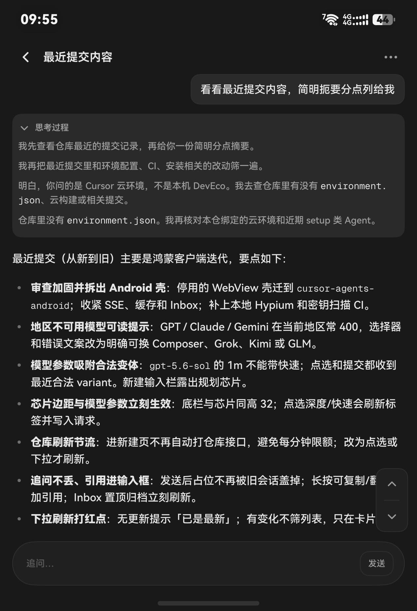
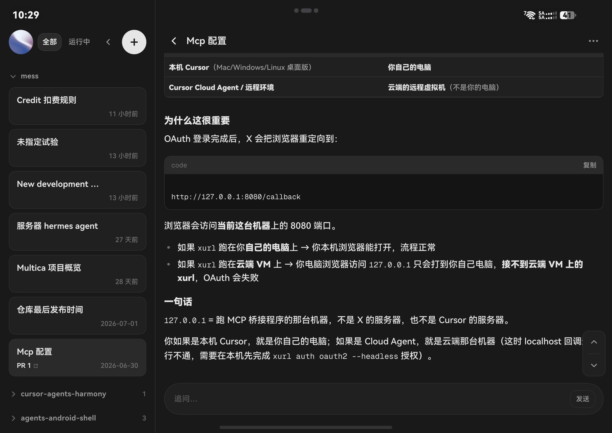

# Cursor Agents for HarmonyOS

HarmonyOS 上的 Cursor Cloud Agents 指挥台。用 ArkUI 原生界面管理账号下的云端任务：查看队列、创建任务、跟随执行过程、追问、取消，并打开结果与 Pull Request。数据直连 [Cursor 官方 API](https://cursor.com/docs/api)（`https://api.cursor.com`），与 [cursor.com/agents](https://cursor.com/agents) 上的是同一批任务。

包名 `com.brian.cursor.mobile`。工程目标 SDK 为 HarmonyOS `6.1.1(24)`，设备类型为 phone 与 tablet。主力适配华为 Pura X Max 的外屏与内屏。

仓库：[`treeatetree/cursor-agents-harmony`](https://github.com/treeatetree/cursor-agents-harmony)。  
卓易通 WebView 壳在独立仓库 [`treeatetree/cursor-agents-android`](https://github.com/treeatetree/cursor-agents-android)，本仓库只含鸿蒙工程。

## 界面

截图来自 Pura X Max 真机（2026 年 8 月）。左图是外屏上的任务详情，右图是内屏横向展开后的分栏。

<p>
  
  &nbsp;
  
</p>

## 功能

### 收件箱

收件箱是任务队列。顶栏按全部、运行中、失败、已完成筛选。任务按仓库分组，分组可以展开和收起，置顶单独成组。外屏与内屏竖向使用固定双列、等高卡片；只有内屏横向改成左侧列表加右侧详情。

列表优先读本地缓存，再与云端对齐。有任务在运行时会短间隔刷新状态。已结束的任务在离线时仍可从缓存打开。未读任务以描边标出。长按卡片可归档。下拉刷新；没有变化时不打乱列表。

### 新建任务

新建页是一块贴顶的输入区，加上仓库、模型、规划或自动、图片和自动创建 PR。仓库以卡片列出，可指定分支。模型按速度用中文标出。选「自动」只切换当前选项，不会把整页关掉。图片从系统相册选取。

### 任务详情

详情是这条云端任务的记录。正文用 Markdown 显示。思考过程、推理和工具调用默认收起，点开后保持展开，后续流式更新不会再把它合上。进行中的任务在底部显示当前状态，离开页面后连接仍留在进程里。

底部可以追问。进行中的任务可以取消。标题旁可以展开仓库、耗时、Pull Request 和产物。链接只接受安全的 `https` 地址。

### 账号与设置

在设置中粘贴 User API Key。应用调用 `/v1/me` 校验，通过后显示姓名、邮箱和 Key 名称。Key 用 HUKS AES-256-GCM 加密后存放，只在内存中解密使用，日志里会打码。

设置还包括主题（跟随系统、浅色、深色）、默认是否自动创建 PR、触觉、音效，以及完成通知是否展示摘要。清除 Key 前会要求确认。

### 折叠与系统行为

布局随折叠和方向变化：外屏与内屏竖向为双列，内屏横向为分栏。断网时收件箱给出状态提示，已缓存的内容仍可阅读。键盘弹起时输入区让出空间。

## 范围

本应用负责启动、跟进、追问和取消云端 Agent，并查看结果与 Pull Request。

范围之外：本地 IDE、Secrets 与 MCP 的管理后台、远程桌面，以及用网页壳包一层 cursor.com。

验收项见 `ACCEPTANCE_CHECKLIST.txt`。

## 环境

- DevEco Studio，HarmonyOS SDK，工程 target `6.1.1(24)`
- 真机建议华为 Pura X Max；phone 与 tablet 也可安装
- 签名材料放在被 Git 忽略的 `build-profile.local.json5`，不要写入仓库

## 构建与安装

```bash
# 无线调试。端口来自手机「无线调试」页
./scripts/wifi-connect.sh connect <ip:port>

# 秘密扫描与编译
./scripts/check-secrets.sh
./scripts/build.sh

# 安装并启动
./scripts/install.sh

# 真机 Hypium。走 onDeviceTest，不要用 hvigor test
./scripts/test.sh

# 截当前屏幕与控件树，输出到 .cursor/review-shots/（不提交）
./scripts/device-qa.sh capture qa-inbox
```

GitHub Actions 只做秘密扫描和验收清单门禁。HAP 编译与 Hypium 需要在装有 DevEco 的本机运行。锁屏时启动会失败，解锁后再打开应用。

## 获取 API Key

在 [cursor.com/dashboard/api](https://cursor.com/dashboard/api) 创建 User API Key（以 `crsr_` 开头），打开应用的设置页粘贴并验证。
